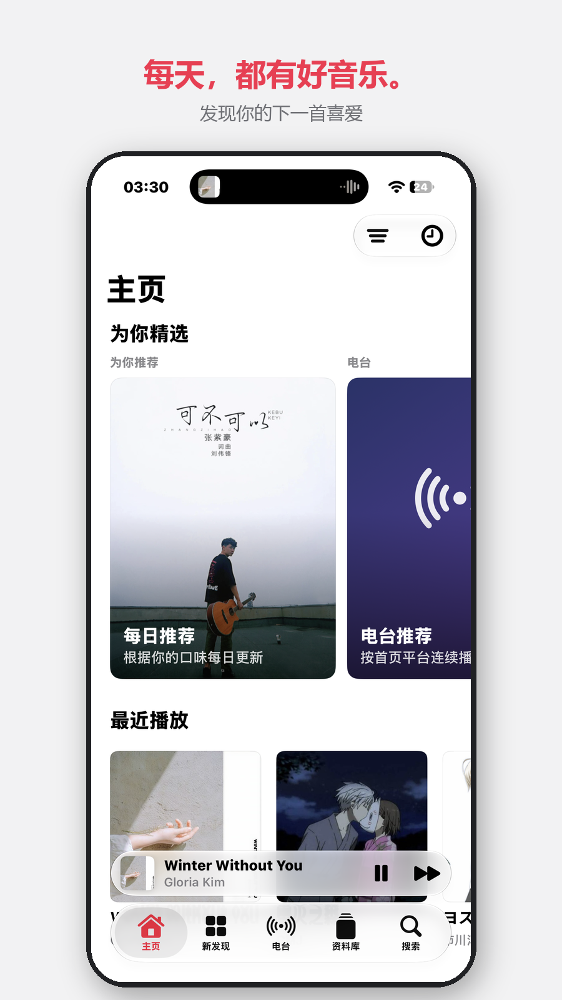
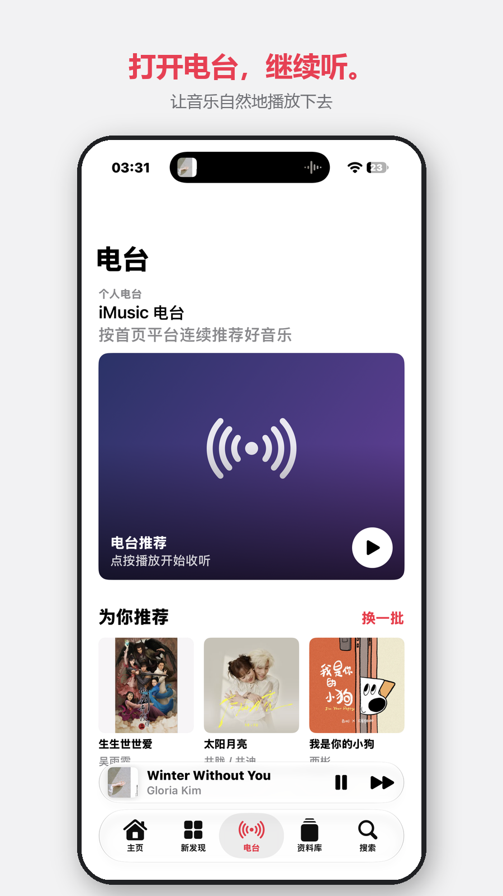
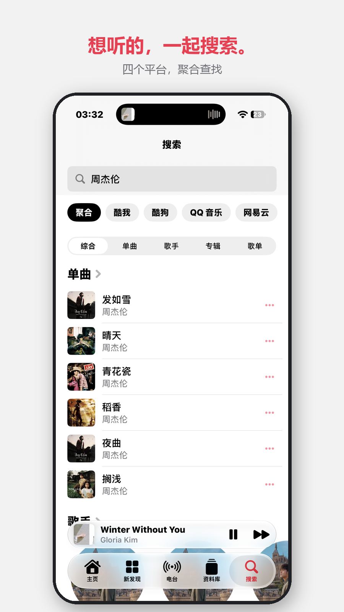
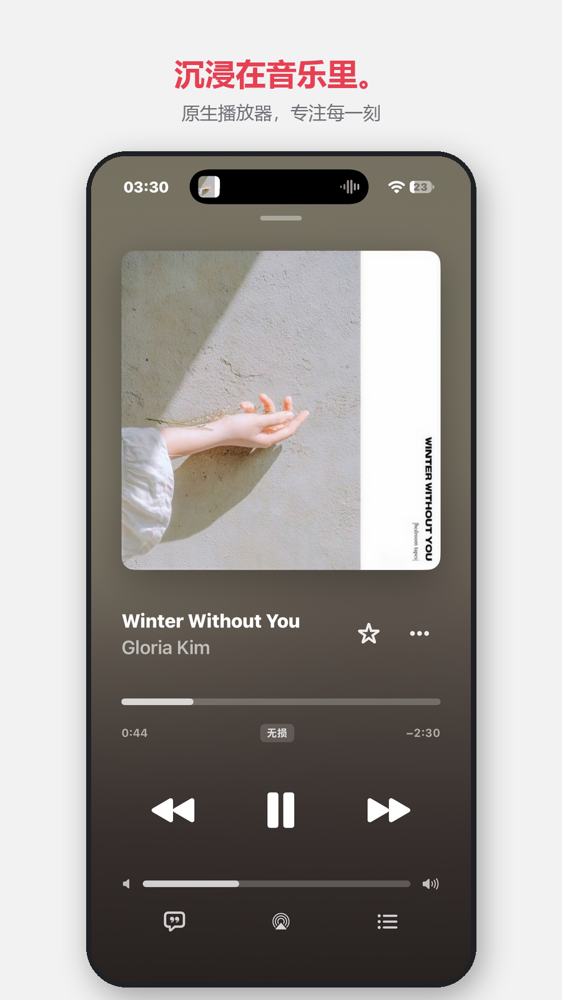
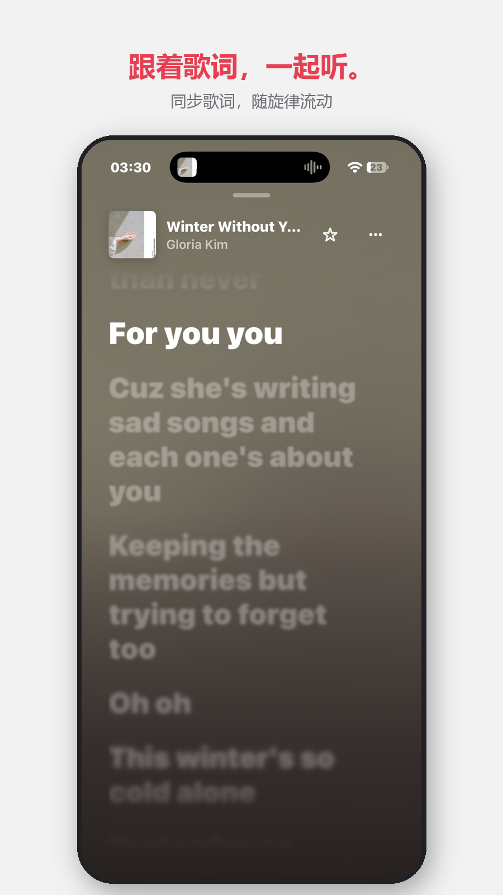

<div align="right"><a href="README.md">简体中文</a> | English</div>

<div align="center">


# iMusic

**Discover, collect and listen in one place.**

SwiftUI · System Liquid Glass · LX User API · LX Sync Server

[](#build)
[](platforms/ios/Package.swift)
[](LICENSE)
[](COPYING)

</div>

iMusic is a native iOS music client built on [Moumusic](https://github.com/jiajia2222/Moumusic). Home, Discovery, Radio, Library and Search share a familiar tab bar, with SwiftUI navigation and system Liquid Glass.

Search across QQ Music, NetEase Cloud Music, Kuwo and Kugou, and use imported LX User API sources for playback. Availability depends on the source and provider; automatic mode may also use an eligible signed-in account.

QQ Music and NetEase public playlists are imported as editable local copies. Edits to those copies stay in iMusic and are not written to the originating provider playlist. Local favorites and compatible playlists can sync across devices through a self-hosted [LX Sync Server](https://github.com/lyswhut/lx-music-sync-server). Source scripts are managed locally on each device.

## Screenshots

<div align="center">





</div>

## Features

- Native Home, Discovery, Radio, Library and Search tabs, with light and dark appearances
- Artist, album and playlist details, mini-player, full-screen player, queue and synchronized lyrics
- Native Lock Screen and Control Center playback controls
- User-managed LX source import, availability check, enable/disable, switching, export and deletion
- Multi-platform catalog search and source-resolved playback
- Local favorites, recently played tracks and editable playlists
- QQ Music and NetEase public playlist imports as local copies
- Optional LX Sync for compatible favorites and playlists
- iOS 27 system Liquid Glass, with transparency and tint following iPhone display and accessibility settings
- Continuous decorative animations and audio spectrum analysis are throttled or paused for Low Power Mode, thermal pressure and inactive scenes. During background playback, progress and lyric-cursor callbacks slow from 0.2 to 1 second
- Automatic New Discovery refresh is throttled to at most once every ten minutes

The default target does not include an in-app audio-download screen, Home Screen widgets, custom Live Activities or CarPlay integration. The lock screen and Dynamic Island use the native iOS Now Playing card. The player can reuse local audio files that are already present.

## Sources and synchronization

Open **Library → More → Manage LX Sources** to import a source from a file or URL and check its availability. No third-party source URLs are bundled.

Open **Library → Sync Library** to enter an LX Sync Server address and connection code. The client syncs compatible favorites and playlists. LX Sync does not carry LX source scripts, so import those on each device. Edits to imported QQ Music and NetEase copies remain local to iMusic and do not modify the provider playlists.

## Build

The iOS application requires macOS and Xcode. XcodeGen generates the app target:

```sh
cd platforms/ios/ios
xcodegen generate
xcodebuild -project KumoneIOS.xcodeproj -scheme KumoneIOS -configuration Release -sdk iphoneos CODE_SIGNING_ALLOWED=NO build
```

The deployment target is iOS 27 and the app is designed for standard iPhone sizes. It does not include a foldable-specific layout.

## Project layout

```text
platforms/ios/
├── Sources/Kumone/
│   ├── Core/API/          Catalog, playlist import and LX source bridge
│   ├── Core/Models/       Track, playlist and lyric models
│   ├── Core/Player/       AVPlayer, queue, lyrics and system playback state
│   ├── Core/Storage/      Local library, source configuration and account data
│   ├── Core/Sync/         LX Sync wire models and client
│   ├── DesignSystem/      SwiftUI theme, Liquid Glass and rendering budget
│   └── Features/          Home, New Discovery, Radio, Library, Search, settings and player
├── ios/                   iOS app shell, tests and XcodeGen manifest
└── docs/                  Product icon and screenshots
platforms/android/         Preserved upstream subtree; not part of the iMusic iOS target
```

## Upstream and licensing

- [Moumusic](https://github.com/jiajia2222/Moumusic) — native iOS project foundation
- [LX Music Mobile](https://github.com/lyswhut/lx-music-mobile) — LX source and data protocol reference
- [LX Sync Server](https://github.com/lyswhut/lx-music-sync-server) — compatible self-hosted sync service

Upstream source files, assets and notices retain their original license obligations. See [THIRD_PARTY_NOTICES.md](THIRD_PARTY_NOTICES.md), [LICENSE](LICENSE) and [COPYING](COPYING).
